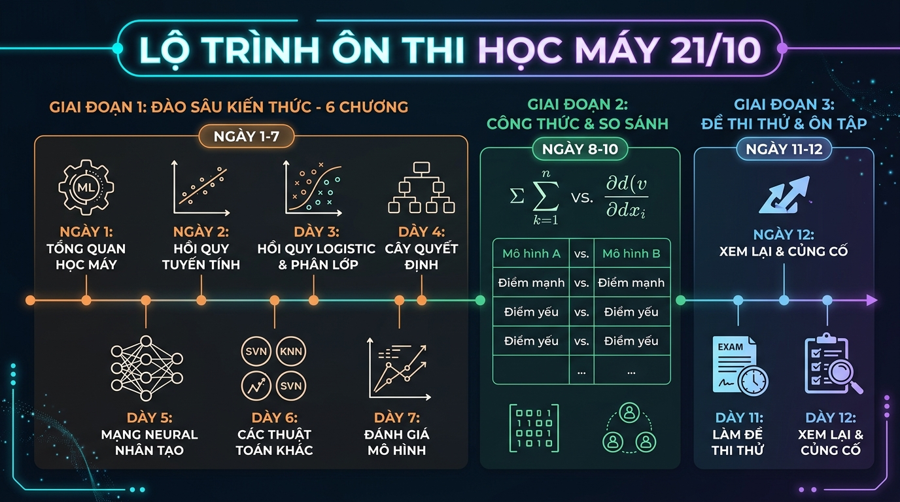

# 🎯 CONTEXT & BẢN ĐỒ KẾ HOẠCH ÔN TẬP 100 CÂU TRẮC NGHIỆM ĐỀ ĐÓNG
## MÔN HỌC: HỌC MÁY TIÊN TIẾN VÀ ỨNG DỤNG (UIT)



---

### 1. Bối cảnh & Mục tiêu kỳ thi
* **Ngày thi:** Ngày **21/10** (Đề đóng - 100 câu trắc nghiệm).
* **Quỹ thời gian ôn tập:** 12 ngày trọn vẹn (Từ **09/10** đến hết **20/10**).
* **Phạm vi tài liệu:** 6 slide bài giảng (~520 trang) của TS. Hà Minh Tân.
* **Tình trạng xuất phát điểm:** *"Đi học chỉ nghe giảng sơ sơ, sợ không ôn kịp"*.
* **Mục tiêu điểm số:** $\ge 8.5/10$ (Tự tin vượt qua mọi câu hỏi lý thuyết và bài tập bấm máy tính).

---

### 2. Tư duy ôn thi trắc nghiệm "tốc hành" (Không học vẹt, học bản chất)
Đề thi 100 câu trắc nghiệm đề đóng có độ phủ rất rộng nhưng **không đòi hỏi chứng minh toán học phức tạp**. Thay vào đó, đề sẽ kiểm tra:
1. **Khái niệm & Bản chất thuật toán (65%):** Thuật toán này dùng khi nào? Giả định của nó là gì? Ưu nhược điểm so với thuật toán khác?
2. **Tính toán bấm máy tính nhanh (25%):** Áp dụng công thức 1–2 bước ra kết quả (Entropy, Gini, Confusion matrix, số tham số mạng MLP, chuẩn hóa dữ liệu...).
3. **Các câu gài / bẫy câu chữ (10%):** Nhận diện các câu khẳng định tuyệt đối ("luôn luôn", "chỉ duy nhất"), các trường hợp ngoại lệ.

👉 **Quy tắc vàng:** Học bằng cách **đối chiếu - so sánh** (Ridge vs Lasso, Bagging vs Boosting, K-Means vs DBSCAN) và **hiểu trực giác hình học**, thay vì học thuộc lòng từng chữ trên slide.

---

### 3. Lộ trình 12 ngày chi tiết (09/10 – 20/10)

```
GIAI ĐOẠN 1: CÀN QUÉT 6 CHƯƠNG (09/10 - 15/10)
├── 09/10 (Ngày 1): Chương 1 - Tổng quan học máy, T-E-P, Các kiểu học & huấn luyện
├── 10/10 (Ngày 2): Chương 2 - Tiền xử lý, Missing data, Scaling, One-Hot & PCA
├── 11/10 (Ngày 3): Chương 3 (P1) - OLS tuyến tính, MLE, Ridge vs Lasso vs Elastic Net
├── 12/10 (Ngày 4): Chương 3 (P2) - Logistic Regression, Softmax, Metrics & Data Leakage
├── 13/10 (Ngày 5): Chương 4 - Cây quyết định, Entropy/Gini, Bagging, Random Forest & Boosting
├── 14/10 (Ngày 6): Chương 5 - Phân cụm, K-Means, K-Means++, GMM (EM) & DBSCAN
└── 15/10 (Ngày 7): Chương 6 - MLP, Hàm kích hoạt phi tuyến, Backprop, GD variants

GIAI ĐOẠN 2: TÍNH TOÁN & ĐỐI CHIẾU MA TRẬN (16/10 - 18/10)
├── 16/10 (Ngày 8): Chuyên đề bài tập bấm máy tính nhanh trong <= 60s
├── 17/10 (Ngày 9): Nằm lòng 6 Bảng so sánh "Sống còn" & 30+ Bẫy trắc nghiệm
└── 18/10 (Ngày 10): Phản xạ nhanh 100 câu hỏi tự vấn (Flashcard reflection)

GIAI ĐOẠN 3: TỔNG DUYỆT & THI (19/10 - 20/10)
├── 19/10 (Ngày 11): Thi thử Mock Test 100 câu bấm giờ nghiêm ngặt + Ghi Sổ tay sai sót
├── 20/10 (Ngày 12): Xem lại Sổ tay sai sót, thư giãn đầu óc, ngủ sớm trước 22h
└── 21/10: BƯỚC VÀO PHÒNG THI VÀ CHIẾN THẮNG!
```

---

### 4. Hệ thống các file ghi chú được tách gọn trong thư mục này

Bộ tài liệu này đã được tách thành các file chuyên đề ngắn gọn, trình bày theo phong cách ghi chú thân thiện ("note lại cho bạn hiểu"):

* 📘 [01_Note_Chuong_1_Tong_Quan_Hoc_May.md](file:///c:/Users/LENOVO/OneDrive%20-%20Tr%C6%B0%E1%BB%9Dng%20%C4%90H%20CNTT%20-%20University%20of%20Information%20Technology/_H%E1%BB%8Dc%20m%C3%A1y%20ti%C3%AAn%20ti%E1%BA%BFn%20v%C3%A0%20%E1%BB%A9ng%20d%E1%BB%A5ng/%C3%B4n%20t%E1%BA%ADp%2021-10/01_Note_Chuong_1_Tong_Quan_Hoc_May.md): Khái niệm AI/ML/DL, công thức Tom Mitchell, các kiểu học, tham số vs siêu tham số, Overfitting.
* 📗 [02_Note_Chuong_2_Tien_Xu_Ly_Du_Lieu.md](file:///c:/Users/LENOVO/OneDrive%20-%20Tr%C6%B0%E1%BB%9Dng%20%C4%90H%20CNTT%20-%20University%20of%20Information%20Technology/_H%E1%BB%8Dc%20m%C3%A1y%20ti%C3%AAn%20ti%E1%BA%BFn%20v%C3%A0%20%E1%BB%A9ng%20d%E1%BB%A5ng/%C3%B4n%20t%E1%BA%ADp%2021-10/02_Note_Chuong_2_Tien_Xu_Ly_Du_Lieu.md): 4 chiều chất lượng dữ liệu, xử lý missing data, Min-Max vs Z-score, One-Hot, PCA 7 bước.
* 📕 [03_Note_Chuong_3_Cac_Mo_Hinh_Tuyen_Tinh_Va_Danh_Gia.md](file:///c:/Users/LENOVO/OneDrive%20-%20Tr%C6%B0%E1%BB%9Dng%20%C4%90H%20CNTT%20-%20University%20of%20Information%20Technology/_H%E1%BB%8Dc%20m%C3%A1y%20ti%C3%AAn%20ti%E1%BA%BFn%20v%C3%A0%20%E1%BB%A9ng%20d%E1%BB%A5ng/%C3%B4n%20t%E1%BA%ADp%2021-10/03_Note_Chuong_3_Cac_Mo_Hinh_Tuyen_Tinh_Va_Danh_Gia.md): Hồi quy OLS, Ridge vs Lasso, Logistic Regression, Confusion Matrix, Precision/Recall/F1, Data Leakage.
* 📙 [04_Note_Chuong_4_Cay_Quyet_Dinh_Va_Ensemble.md](file:///c:/Users/LENOVO/OneDrive%20-%20Tr%C6%B0%E1%BB%9Dng%20%C4%90H%20CNTT%20-%20University%20of%20Information%20Technology/_H%E1%BB%8Dc%20m%C3%A1y%20ti%C3%AAn%20ti%E1%BA%BFn%20v%C3%A0%20%E1%BB%A9ng%20d%E1%BB%A5ng/%C3%B4n%20t%E1%BA%ADp%2021-10/04_Note_Chuong_4_Cay_Quyet_Dinh_Va_Ensemble.md): Decision Tree, Entropy, Gini, ID3 vs CART, Bagging (Random Forest, OOB 36.8%) vs Boosting (AdaBoost, Gradient Boosting).
* 📓 [05_Note_Chuong_5_Bai_Toan_Phan_Cum.md](file:///c:/Users/LENOVO/OneDrive%20-%20Tr%C6%B0%E1%BB%9Dng%20%C4%90H%20CNTT%20-%20University%20of%20Information%20Technology/_H%E1%BB%8Dc%20m%C3%A1y%20ti%C3%AAn%20ti%E1%BA%BFn%20v%C3%A0%20%E1%BB%A9ng%20d%E1%BB%A5ng/%C3%B4n%20t%E1%BA%ADp%2021-10/05_Note_Chuong_5_Bai_Toan_Phan_Cum.md): Phân cụm không giám sát, K-Means, K-Means++, Hệ số Silhouette, GMM (EM), DBSCAN (mật độ, khử nhiễu).
* 🗂️ [06_Note_Chuong_6_MLP_Multi_Layer_Perceptron.md](file:///c:/Users/LENOVO/OneDrive%20-%20Tr%C6%B0%E1%BB%9Dng%20%C4%90H%20CNTT%20-%20University%20of%20Information%20Technology/_H%E1%BB%8Dc%20m%C3%A1y%20ti%C3%AAn%20ti%E1%BA%BFn%20v%C3%A0%20%E1%BB%A9ng%20d%E1%BB%A5ng/%C3%B4n%20t%E1%BA%ADp%2021-10/06_Note_Chuong_6_MLP_Multi_Layer_Perceptron.md): Perceptron, XOR problem, Vai trò hàm kích hoạt phi tuyến, Sigmoid/Tanh/ReLU, Backpropagation, Batch GD vs SGD vs Mini-batch GD.
* 📸 [07_Note_Chuong_7_CNN_Mang_Tich_Chap.md](file:///c:/Users/LENOVO/OneDrive%20-%20Tr%C6%B0%E1%BB%9Dng%20%C4%90H%20CNTT%20-%20University%20of%20Information%20Technology/_H%E1%BB%8Dc%20m%C3%A1y%20ti%C3%AAn%20ti%E1%BA%BFn%20v%C3%A0%20%E1%BB%A9ng%20d%E1%BB%A5ng/%C3%B4n%20t%E1%BA%ADp%2021-10/07_Note_Chuong_7_CNN_Mang_Tich_Chap.md): Mạng tích chập CNN, Local Connectivity & Weight Sharing, Conv, Pooling, Flatten, Fully Connected, Softmax, Công thức kích thước Output, 5 kiến trúc kinh điển (LeNet-5, AlexNet, VGGNet, GoogLeNet, ResNet) & 4 bài toán thị giác máy tính.
* 📝 [07_So_Tay_Cong_Thuc_Va_Bay_Trac_Nghiem.md](file:///c:/Users/LENOVO/OneDrive%20-%20Tr%C6%B0%E1%BB%9Dng%20%C4%90H%20CNTT%20-%20University%20of%20Information%20Technology/_H%E1%BB%8Dc%20m%C3%A1y%20ti%C3%AAn%20ti%E1%BA%BFn%20v%C3%A0%20%E1%BB%A9ng%20d%E1%BB%A5ng/%C3%B4n%20t%E1%BA%ADp%2021-10/07_So_Tay_Cong_Thuc_Va_Bay_Trac_Nghiem.md): Bảng tổng hợp công thức bấm máy tính, 6 bảng so sánh ma trận sống còn, 30+ bẫy trắc nghiệm hay ra và chiến thuật phòng thi 3 vòng.
* 🌐 **Ứng dụng Web Luyện thi Trắc nghiệm:** [web/index.html](file:///c:/Users/LENOVO/OneDrive%20-%20Tr%C6%B0%E1%BB%9Dng%20%C4%90H%20CNTT%20-%20University%20of%20Information%20Technology/_H%E1%BB%8Dc%20m%C3%A1y%20ti%C3%AAn%20ti%E1%BA%BFn%20v%C3%A0%20%E1%BB%A9ng%20d%E1%BB%A5ng/%C3%B4n%20t%E1%BA%ADp%2021-10/web/index.html) - Hệ thống 400 câu hỏi, có **giải thích tức thì sau mỗi câu**, chế độ thi thử 100 câu bấm giờ mô phỏng phòng thi, Sổ tay lưu câu sai tự động, Flashcards và lưu tiến độ `localStorage` chạy hoàn toàn offline không cần cài đặt!

---

> [!TIP]
> Bạn có thể nhấp đúp chuột mở trực tiếp [web/index.html](file:///c:/Users/LENOVO/OneDrive%20-%20Tr%C6%B0%E1%BB%9Dng%20%C4%90H%20CNTT%20-%20University%20of%20Information%20Technology/_H%E1%BB%8Dc%20m%C3%A1y%20ti%C3%AAn%20ti%E1%BA%BFn%20v%C3%A0%20%E1%BB%A9ng%20d%E1%BB%A5ng/%C3%B4n%20t%E1%BA%ADp%2021-10/web/index.html) bằng bất kỳ trình duyệt nào (Chrome, Edge, Cốc Cốc) để bắt đầu luyện tập trắc nghiệm và thi thử ngay lập tức!
